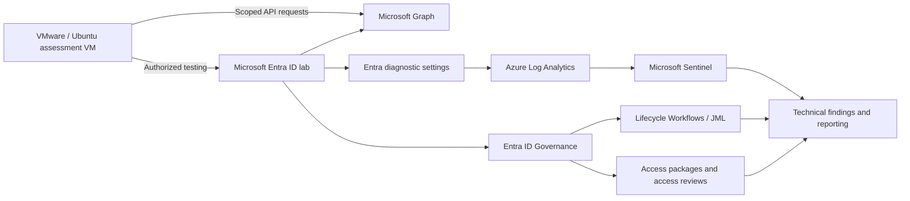

# Identity Recon | IAM Security Assessment & Governance Lab

**Author:** Taiwei Ko  
**Focus:** Microsoft Entra ID · Identity security · Privileged access · OAuth and token risks · Identity Governance · Microsoft Sentinel  
**Environment:** Personally controlled, authorized Microsoft Entra training tenant with synthetic identities; **not production**  
**Status:** In progress — Checkpoints 2–7 documented  
**Last updated:** November 13, 2026

## Project overview

Identity Recon is my hands-on IAM engineering and security assessment portfolio. The project follows an identity attack and defense lifecycle: **build monitoring, prepare assessment tooling, examine initial access, assess identity compromise and persistence, and implement identity governance controls**.

I document the engineering problem, my implementation, what the lab results actually demonstrate, gaps that remain untested, and controls an IAM engineer or architect would recommend. The repository is organized around technical reports, executive security updates, and supporting evidence—not reproduced course instructions.

> **Evidence standard:** **Validated** means a specific outcome is supported by an artifact reviewed for the relevant claim. **Completed (self-reported)** means I performed a lab exercise but did not supply independently reviewed execution evidence. **Configured / partially validated** means a control was created but successful end-to-end operation has not yet been shown. Findings here apply only to an authorized learning environment.

## Architecture and assessment boundaries



**Technologies used:** VMware, Ubuntu, Docker, Azure CLI, ROADrecon, AzureHound, BloodHound, Microsoft Entra ID, Microsoft Graph, Microsoft Sentinel, Azure Log Analytics, Entra Lifecycle Workflows, Entitlement Management, and Access Reviews. Installation does not imply every tool was exercised or independently validated.

- [Identity monitoring architecture](architecture/identity-monitoring.md)
- [Security and confidentiality guidelines](SECURITY.md)

## Checkpoint progress

| Checkpoint | Engineering work | Evidence / outcome | Reports |
|---|---|---|---|
| **02 — Range Setup** | Created Entra lab environment, Log Analytics workspace, Sentinel integration, and diagnostic routing | **Validated ingestion:** 122 sign-in and 29 audit events in the queried 24-hour window on Nov. 8, 2026 | [Technical](reports/2026-11-08-checkpoint-02-technical.md) · [CISO](reports/2026-11-08-checkpoint-02-ciso.md) |
| **03 — Attack Box Build** | Set up VMware Ubuntu VM; installed Docker, Azure CLI, ROADrecon, AzureHound and BloodHound | **Setup completed (self-reported)**; screenshots intentionally omitted; tool operation not independently audited | [Technical](reports/2026-11-08-checkpoint-03-technical.md) |
| **04 — Recon & Initial Access** | Seeded 10 synthetic identities; examined unauthenticated tenant discovery, password spraying and a fictional leaked-credential/credential-stuffing scenario | **Exercises documented:** exact login outcomes and defender detections not independently validated | [Technical](reports/2026-11-08-checkpoint-04-technical.md) · [Executive](reports/2026-11-08-checkpoint-04-executive.md) |
| **05 — Post-Exploitation** | Used ROADrecon for authenticated enumeration; simulated device-code phishing; reported bearer-token reuse for scoped Graph access | **Completed (self-reported)**; permissions, token constraints and detection results not independently audited | [Technical](reports/2026-11-09-checkpoint-05-technical.md) · [Executive](reports/2026-11-09-checkpoint-05-executive.md) |
| **06 — Escalation & Persistence** | Reported app-consent abuse, service principal credentials, privileged group/PIM escalation, separate privileged identity, app ownership and group membership changes | **Completed (self-reported)**; terminal outputs and audit evidence not independently reviewed; federation trust abuse not claimed | [Technical](reports/2026-11-12-checkpoint-06-technical.md) · [Executive](reports/2026-11-12-checkpoint-06-executive.md) |
| **07 — Identity Governance** | Configured joiner/mover/leaver workflows, an IT support access package and an IT Ops privileged-group access review | **Configured; partially validated:** joiner task failure, leaver tasks completed but overall run in progress, package/review untested | [Technical](reports/2026-11-13-checkpoint-07-technical.md) · [Executive](reports/2026-11-13-checkpoint-07-executive.md) |
| **08–12 — Defense & Enterprise Identity** | Zero Trust, non-human identities, hybrid AD, Okta, governance wrap-up | Not yet documented | — |
| **13 — Capstone & Incident Response** | Final investigation, findings, remediation and reporting | Not yet documented | — |

**Publishing note:** The Checkpoint 7 reports and images were prepared separately and must be uploaded to the paths shown below; their relative links will work once those files are in this repository. Checkpoints 2–6 reports are already present on GitHub.

## Key results and findings

### Checkpoint 2 — Identity monitoring foundation

Microsoft Entra diagnostic settings route selected identity events to Azure Log Analytics for investigation through Sentinel. On **November 8, 2026**, two KQL screenshots demonstrated queryable records in the selected workspace:

| Log table | Events in the 24-hour test window | Evidence |
|---|---:|---|
| `SigninLogs` | **122** | [Sign-in result](evidence/checkpoint-02/07-signinLogs.png) |
| `AuditLogs` | **29** | [Audit result](evidence/checkpoint-02/06-auditLogs.png) |

[View all Checkpoint 2 screenshots](evidence/checkpoint-02/). These are historical, point-in-time results—not proof of complete logging coverage, sustained ingestion or Sentinel alert effectiveness.

### Checkpoints 4–6 — Identity threat and persistence assessment

These authorized lab scenarios showed how identity risk can develop across multiple trust boundaries:

| Security theme | Engineering takeaway | Defensive response |
|---|---|---|
| Tenant discovery and initial access | Public OpenID Connect metadata is intended protocol behavior, not a vulnerability on its own; weak or reused credentials increase account-takeover risk | Phishing-resistant MFA, smart lockout, Conditional Access and sign-in monitoring |
| Device-code workflow abuse | A genuine Microsoft authentication page can accompany a misleading authorization request | Restrict device-code flow when unnecessary; verify application/client context |
| Bearer-token reuse | A valid token may permit authorized API requests without a new interactive password/MFA prompt, within its scope and validity | Endpoint and token protection, least privilege, resource-side enforcement, revocation procedures |
| Application consent and service principals | Application access and credentials can persist independently of changes to an initially compromised user | Govern consent, permissions, credentials, service principal sign-ins and app ownership |
| Privileged groups and additional admins | Unsafe membership/role controls can create alternate privileged access paths | Protect role-assignable groups and PIM assignments; review privileged accounts and role changes |

**Checkpoint 6 finding:** Restoring the first compromised identity is not necessarily sufficient if independent application credentials, privileged accounts, role assignments, or ownership relationships remain. The lab reports these outcomes; actual effective permissions and detection events were not independently validated. Token reuse should **not** be described as universally undetectable or as bypassing every access control.

### Checkpoint 7 — Identity governance and control assurance

This checkpoint moved from offensive testing toward preventing and governing excessive or stale access through **Entra Lifecycle Workflows, Entitlement Management and Access Reviews**.

| Control | Observed result from Nov. 13, 2026 screenshots | What remains |
|---|---|---|
| **Joiner workflow** | Account-enable task **Completed** (account already enabled); welcome email **Failed** due to missing/invalid manager attribute; group task **Cancelled** | Repair manager-dependent task configuration, investigate cancellation, and rerun end-to-end |
| **Mover workflow** | Setup reported | Capture or document a before/after entitlement change |
| **Leaver workflow** | Disable-account, group-removal and Teams-removal tasks **Completed**; overall run still **In progress** when captured. No original group/Teams memberships were present | Confirm terminal workflow status; retest removal against an account with a known harmless membership |
| **IT Support access package** | One resource role and one enabled policy; **zero assignments** | Verify request/approval, assignment, and removal/expiry |
| **IT Ops access review** | One member awaiting review; one-time review set for Nov. 13–16; status **Not started** | Record reviewer decision and verify its application |

**Notable finding:** A configured workflow does not prove successful onboarding or offboarding. The joiner failure is a documented engineering issue to investigate, not something to hide in a portfolio. The access package and access review were configured, but their full effectiveness remains unproven.

- [Checkpoint 7 technical governance report](reports/2026-11-13-checkpoint-07-technical.md)
- [Checkpoint 7 executive update](reports/2026-11-13-checkpoint-07-executive.md)
- [Checkpoint 7 screenshots](evidence/checkpoint-07/)

## Repository organization

```text
identity-recon-security-lab/
├── README.md
├── SECURITY.md
├── architecture/
│   └── identity-monitoring.md
├── reports/
│   ├── 2026-11-08-checkpoint-02-{technical,ciso}.md
│   ├── 2026-11-08-checkpoint-03-technical.md
│   ├── 2026-11-08-checkpoint-04-{technical,executive}.md
│   ├── 2026-11-09-checkpoint-05-{technical,executive}.md
│   ├── 2026-11-12-checkpoint-06-{technical,executive}.md
│   └── 2026-11-13-checkpoint-07-{technical,executive}.md  # upload pending
├── evidence/
│   ├── checkpoint-02/  # deployed monitoring and KQL evidence
│   └── checkpoint-07/  # six governance images; upload pending
└── queries/
    ├── validate-signins.kql
    └── validate-audits.kql
```

Only the Checkpoint 2 queries are included; no additional KQL files were requested for the subsequent assessment reports.

## Next engineering priorities

1. **Fix and retest the joiner exception:** validate the manager reference, welcome-email settings, group-task dependencies and final user access state.
2. **Verify governance controls end-to-end:** complete the leaver run, demonstrate actual test-group removal, execute an access-package request and finish an access review.
3. **Review privilege and application cleanup:** confirm no unintended privileged users, service principal credentials, consent grants, application owners or group memberships remain after Checkpoint 6 simulations.
4. **Validate monitoring assumptions:** assess relevant sign-in and audit telemetry, Sentinel detection content, and whether duplicate monitoring resources or retention settings need attention.
5. **Continue Checkpoint 8 — Zero Trust & Defense** after recording the remaining Checkpoint 7 validation gaps.

## Authorization and confidentiality

All exercises described here are limited to an owned, authorized lab tenant and synthetic accounts. This public repository must not contain live passwords, private keys, client secrets, bearer tokens, device codes, authentication caches, realistic phishing templates, sensitive directory exports, or unredacted identifiers. Any historical test artifacts that could grant access should be revoked or removed after the exercise.

This is a personal educational portfolio; it is **not** a production security audit, an independent penetration-testing attestation, or a project endorsed by Microsoft or Cybernoia Labs.
