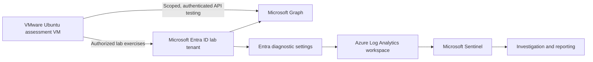

# Identity Recon | IAM Security Assessment & Defense Lab

**Author:** Taiwei Ko  
**Focus:** Microsoft Entra ID · Identity security · OAuth/token security · Azure Log Analytics · Microsoft Sentinel  
**Environment:** Personally controlled, authorized training tenant — **not a production environment**  
**Project status:** In progress · Checkpoints 2–5 documented  
**Last updated:** November 9, 2026

## Project overview

Identity Recon is a hands-on **identity and access management (IAM) security portfolio** documenting how I build an identity lab, assess common identity attack paths, and translate technical observations into engineering recommendations and leadership-ready reports.

My goal is to demonstrate **what I configured, what I tested, what the results support, and which controls can reduce the risk**—rather than reproduce course instructions. Exercises use a controlled Microsoft Entra ID tenant and synthetic identities.

> **Evidence standard:** "Validated" means a specific result is supported by an artifact. "Completed (self-reported)" means I performed the exercise, but the exact results or defender telemetry have not been independently reviewed. This lab does not represent a production security assessment.

## Project architecture

**Assessment tooling:** VMware, Ubuntu, Docker, Azure CLI, ROADrecon, AzureHound, and BloodHound. Installed tooling does not imply every tool was used in every checkpoint. For monitoring architecture details, see [Architecture & design rationale](architecture/identity-monitoring.md).

## Checkpoint progress

| Milestone | Work completed / focus | Evidence status | Reports |
|---|---|---|---|
| **2 — Range Setup** | Entra ID tenant; Log Analytics; Microsoft Sentinel; diagnostic routing; log ingestion | **Validated:** sign-in and audit records queryable on Nov. 8, 2026 | [Technical](reports/2026-11-08-checkpoint-02-technical.md) · [CISO update](reports/2026-11-08-checkpoint-02-ciso.md) |
| **3 — Attack Box Build** | VMware Ubuntu VM prepared with Docker, Azure CLI, ROADrecon, AzureHound and BloodHound | **Setup completed (self-reported)**; no screenshot requirement; tool functionality not independently verified | [Technical](reports/2026-11-08-checkpoint-03-technical.md) |
| **4 — Recon & Initial Access** | Seeded 10 synthetic identities; studied unauthenticated tenant discovery; performed lab initial-access exercises; modeled credential stuffing | **Exercises documented:** individual authentication results and defender detections not independently verified | [Technical](reports/2026-11-08-checkpoint-04-technical.md) · [Executive](reports/2026-11-08-checkpoint-04-executive.md) |
| **5 — Post-Exploitation** | ROADrecon authenticated exploration; device-code phishing simulation; bearer-token reuse for scoped Graph requests | **Completed (self-reported):** exact permissions, token behavior and detections not independently verified | [Technical](reports/2026-11-09-checkpoint-05-technical.md) · [Executive](reports/2026-11-09-checkpoint-05-executive.md) |
| **6 — Escalation & Persistence** | Application consent, service principals, privilege boundaries and persistence controls | Upcoming | — |
| **7–12 — Governance & Defense** | Identity lifecycle, access reviews, Conditional Access, PIM, non-human identities, AD and Okta | Upcoming | — |
| **13 — Capstone** | Incident investigation, remediation and final assessment | Upcoming | — |

> **Publishing note:** The Checkpoint 5 report links become active once the two accompanying Checkpoint 5 Markdown files are uploaded to `reports/`. Checkpoints 2–4 reports are already present in the GitHub repository.

## Featured result — Checkpoint 2: Identity monitoring

**Problem:** Identity investigations depend on reliable authentication and directory audit telemetry. Without log ingestion, monitoring and incident-response tests lack evidence.

**Implementation:** Established a lab Entra tenant, deployed an Azure Log Analytics workspace, enabled Microsoft Sentinel, and configured Entra diagnostic log routing.

**Observed validation (November 8, 2026):**

| Log source | Events in queried 24-hour period | Evidence |
|---|---:|---|
| `SigninLogs` | **122** | [Sign-in query screenshot](evidence/checkpoint-02/07-signinLogs.png) |
| `AuditLogs` | **29** | [Audit query screenshot](evidence/checkpoint-02/06-auditLogs.png) |

Additional [Checkpoint 2 screenshots](evidence/checkpoint-02/) show tenant, workspace, Sentinel and diagnostic configuration. The corresponding read-only queries are available in [validate-signins.kql](queries/validate-signins.kql) and [validate-audits.kql](queries/validate-audits.kql).

**Interpretation:** These historical results demonstrate that both log types were queryable in the selected workspace. They **do not** prove complete event coverage, ongoing ingestion, analytic-rule alerting or detection effectiveness.

## Security assessment takeaways — Checkpoints 4–5

| Area | Engineering takeaway | Defensive consideration |
|---|---|---|
| **Unauthenticated discovery** | Public OpenID Connect metadata supports legitimate federation and client discovery; its availability is not by itself a vulnerability | Separate intended protocol metadata from actionable exposure |
| **Password spraying / credential stuffing** | Weak or reused passwords can enable initial-access attempts against synthetic accounts; credential-stuffing breach intelligence was **fictional** in this portfolio | Strong password protections, phishing-resistant MFA, smart lockout, Conditional Access and monitoring |
| **Authenticated enumeration** | A compromised identity may inspect directory information within its granted permissions | Least privilege, application permissions review and auditability |
| **Device-code phishing** | A genuine Microsoft sign-in page does not make the surrounding request trustworthy | Restrict device-code flow where not needed; train users to verify client/application intent |
| **Bearer-token reuse** | A valid bearer token may authorize scoped API calls without another interactive password or MFA prompt | Endpoint/token protection, limited permissions, revocation procedures, and session-aware controls |

**Important limitations:** Checkpoint 4 does not establish a verified number of compromised accounts. Checkpoint 5 results are based on the lab owner's report and are not independent proof of token scope, privilege escalation or detection outcomes. Token reuse should **not** be described as universally undetectable or as bypassing every MFA and access control.

## Reports and technical artifacts

- **Engineering reports** document objectives, scope, implementation, observations, risk and validation limits; see [reports/](reports/).
- **Executive security updates** summarize risk, control implications and next actions for a CISO or security leader.
- **Evidence** is stored by checkpoint under [evidence/](evidence/), with sensitive values redacted before publication.
- **Queries** currently contain Checkpoint 2 ingestion validation artifacts only. No new KQL files are required for Checkpoints 4 or 5.

## Next priorities

1. Review the Checkpoint 4–5 reports for factual accuracy, especially which results were directly observed versus modeled.
2. Validate whether Sentinel recorded the simulated activity and whether any defensive controls blocked or alerted on it.
3. Confirm which monitoring workspace is active and whether duplicate resources, log retention or ingestion charges need attention.
4. Continue to **Checkpoint 6 — Escalation & Persistence**, documenting privilege boundaries and mitigations within the authorized lab.

## Authorization and confidentiality

All testing is restricted to my own authorized lab environment and synthetic identities. This repository excludes active passwords, session or bearer tokens, device codes, working phishing messages, credential dumps, sensitive directory exports, and reusable attack automation. Supporting screenshots and reports must be sanitized before being made public.

See [SECURITY.md](SECURITY.md). This educational portfolio is not affiliated with or endorsed by Microsoft or Cybernoia Labs.
