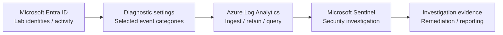

# Identity Recon | Identity Security Monitoring & Defense Lab

**Owner:** Taiwei Ko  
**Focus:** Microsoft Entra ID · Azure Monitor / Log Analytics · Microsoft Sentinel · Identity governance and Zero Trust  
**Environment:** Isolated, authorized educational tenant — **not production**

## Project overview

This independent IAM security portfolio documents the engineering decisions, monitoring controls, tests, and investigation results from hands-on identity-security lab exercises. The goal is to demonstrate **what I built, why it matters, and how I validated it**—not to reproduce course instructions.

The lab begins with a Microsoft Entra ID tenant and centralized identity telemetry. Later milestones will explore identity risks, governance controls, and defensive investigations within an authorized training environment.

## Architecture

See [Architecture & design rationale](architecture/identity-monitoring.md).

## Progress

| Milestone | Engineering outcome | Status | Report |
|---|---|---|---|
| Checkpoint 2 — Range Setup | Entra ID tenant, Log Analytics workspace, Sentinel integration, log-routing work | **Completed (self-reported)**; supporting evidence pending | [Technical](reports/2026-11-08-checkpoint-02-technical.md) · [Executive](reports/2026-11-08-checkpoint-02-ciso.md) |
| Checkpoint 3 — Attack Box Build | Authorized test environment and tooling | Not started / not documented | — |
| Checkpoints 4–6 — Identity Threats | Controlled identity security simulations and defensive findings | Not started / not documented | — |
| Checkpoints 7–12 — Governance and Defense | Identity lifecycle, Zero Trust, non-human identities, AD, Okta | Not started / not documented | — |
| Checkpoint 13 — Capstone | Investigation, remediation and final security report | Not started / not documented | — |

> **Evidence standard:** A lab owner reporting completion is different from independently validated results. Screenshots, KQL outputs and test dates will be added only after capture and redaction. The presence of Microsoft Sentinel alone does not demonstrate full detection coverage.

## Featured milestone: Checkpoint 2

**Challenge:** Identity security investigations depend on identity event visibility. Without a functioning telemetry pipeline, monitoring and incident-response exercises are limited.

**Implementation (reported):** Established the Entra ID lab, built a Log Analytics workspace, enabled Microsoft Sentinel, and completed Entra identity log-routing exercises.

**Outcome:** An identity-monitoring foundation for subsequent controlled exercises. Direct proof of event ingestion and detection validation is still being collected.

**Technical artifacts:**

- [Checkpoint 2 implementation report](reports/2026-11-08-checkpoint-02-technical.md)
- [Checkpoint 2 executive security update](reports/2026-11-08-checkpoint-02-ciso.md)
- [Sign-in telemetry validation query](queries/validate-signins.kql)
- [Audit telemetry validation query](queries/validate-audits.kql)
- [Evidence standard](evidence/README.md)

## Documentation standard

1. **Executive summary** — outcome, risk, limitations, recommended next action.
2. **Technical report** — architecture, configuration, testing, screenshots / outputs.
3. **Reusable artifacts** — queries and other safe, sanitized engineering deliverables.

See [Reporting standards](reports/README.md). This portfolio is not affiliated with or endorsed by Microsoft or Cybernoia Labs.

## Safety and confidentiality

Only test assets that belong to the authorized lab. Never commit credentials, bearer tokens, secrets, unredacted personal data, or live infrastructure details. See [SECURITY.md](SECURITY.md).
