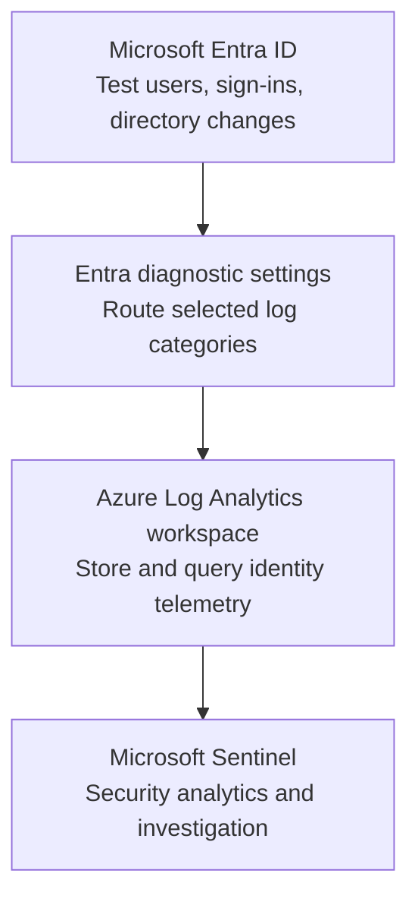

# Architecture: Identity monitoring foundation

**Milestone:** Checkpoint 2 — Range Setup  
**Author:** Taiwei Ko  
**Status:** Deployed; `SigninLogs` and `AuditLogs` ingestion validated by dated November 8, 2026 KQL screenshots. Detection rules remain untested.

## Responsibility boundaries

| Component | Role |
|---|---|
| Microsoft Entra ID | Generates authentication and directory audit events for the lab |
| Entra diagnostic settings | Routes selected supported log categories to the configured destination |
| Azure Log Analytics | Stores and queries ingested records using KQL |
| Microsoft Sentinel | Uses connected telemetry to support security analysis, hunting, investigation and response |

## Design rationale

Centralized telemetry gives future lab exercises a consistent investigation surface. A modular chain also makes troubleshooting easier: failure can occur at event generation, diagnostic routing, ingestion, querying, or detection rules.

## Evidence and remaining questions

- **Validated:** The selected workspace returned **122 `SigninLogs` events** and **29 `AuditLogs` events** during 24-hour queries dated November 8, 2026. [Sign-in evidence](../evidence/checkpoint-02/07-signinLogs.png) · [Audit evidence](../evidence/checkpoint-02/06-auditLogs.png).
- Which diagnostic categories are enabled for the tenant and license?
- What retention, cost and permission controls are configured?
- Two similarly named Log Analytics/Sentinel workspaces (`blastradiulg` and `BlastRadius`) appear in screenshots; confirm which are necessary and avoid deleting resources before checking dependencies.
- Which Sentinel analytic rules, if any, have been **tested**? Do not infer detection readiness merely from enabling Sentinel.

See [Technical report](../reports/2026-11-08-checkpoint-02-technical.md).
