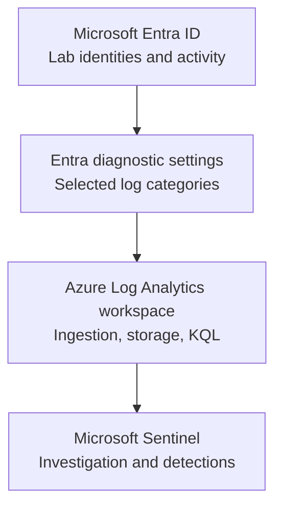

# Technical Implementation Report — Checkpoint 2: Range Setup

**Project:** Identity Recon — Identity Security Monitoring & Defense Lab (Cybernoia IAM Path)  
**Author:** Taiwei Ko  
**Date:** November 8, 2026  
**Environment:** Authorized, isolated training lab  
**Status:** Range Setup complete; sign-in and audit log ingestion validated with dated screenshots (November 8, 2026). Detection-rule effectiveness untested.

## 1. Objective

Create an identity-security test environment with a centralized logging and monitoring pipeline to support future exercises involving authentication anomalies, identity changes, attack detection, and incident investigation.

## 2. Architecture



**Design rationale:** Separate the identity provider, telemetry routing, searchable log storage, and SIEM analysis functions. This creates a measurable pipeline that can be validated independently at each stage.

## 3. Implementation performed

| Workstream | Work reported by lab owner | Engineering relevance |
|---|---|---|
| Entra ID tenant | Set up and identified the lab identity environment | Provides a bounded identity test environment |
| Log Analytics | Created a workspace to receive and query logs | Centralizes telemetry for investigation |
| Microsoft Sentinel | Onboarded Sentinel to the monitoring workspace | Adds a SIEM analysis and investigation layer |
| Log ingestion | Completed the course's Entra diagnostic-routing/ingestion work | Connects identity activity to the monitoring pipeline |

**Configuration fields to capture before publishing a final implementation inventory:** workspace region, retention setting, diagnostic categories enabled, budget configuration, and test activity timestamps. Do not commit secrets, access tokens, or sensitive identifiers.

## 4. Validation plan and evidence

Seven sanitized screenshots are attached. Two dated KQL results confirm nonzero events in the selected workspace during the test window.

| Test | Evidence | Finding |
|---|---|---|
| Entra tenant | [01 — Tenant overview](../evidence/checkpoint-02/01-entra-tenant.png) | Lab tenant and P2 license visible |
| Log Analytics | [02 — Workspace list](../evidence/checkpoint-02/02-log-analytics-workspace.png) | Workspace resources visible |
| Microsoft Sentinel | [03 — Sentinel list](../evidence/checkpoint-02/03-microsoft-sentinel.png) | Sentinel resources visible |
| Diagnostics | [04 — Diagnostic configuration](../evidence/checkpoint-02/04-diagnostic-settings.png) | Log categories and destination selected |
| General telemetry | [05 — Query result](../evidence/checkpoint-02/05-log-ingestion-validation.png) | Microsoft Graph activity records present; not proof of sign-in or audit ingestion |
| `AuditLogs` | [06 — Audit query](../evidence/checkpoint-02/06-auditLogs.png) | **29** events in last 24 hours |
| `SigninLogs` | [07 — Sign-in query](../evidence/checkpoint-02/07-signinLogs.png) | **122** events in last 24 hours |

**Validation date:** November 8, 2026 (as displayed in the screenshots). Counts are point-in-time observations, not ongoing metrics.

### Example validation queries

```kusto
SigninLogs
| where TimeGenerated >= ago(24h)
| summarize EventCount=count(), LatestEvent=max(TimeGenerated)
```

```kusto
AuditLogs
| where TimeGenerated >= ago(24h)
| summarize EventCount=count(), LatestEvent=max(TimeGenerated)
```

**Interpretation:** A nonzero count demonstrates that records of that type were returned within the selected period. It does **not** independently validate full coverage, alerting, or detection effectiveness. Use test identities and sanitized data in screenshots.

## 5. Engineering observations

- **Primary lesson:** Centralizing logs is a prerequisite for investigating identity activity; it is not a substitute for testing detections.
- **Potential failure modes:** Wrong workspace or directory selected, unsupported log categories, missing Azure permissions, ingestion delay, no test activity, overly short query window, or cost/retention misconfiguration.
- **Separation of concerns:** Entra provides identity events; diagnostic settings export selected categories; Log Analytics stores and queries records; Sentinel uses available data for security operations.

## 6. Security outcome and next milestone

**Validated outcome:** The Entra monitoring foundation was deployed. Dated KQL queries demonstrate that the selected workspace contained 122 sign-in and 29 directory audit events within the measured 24-hour window.

**Remaining validation:** Detection rule/alert effectiveness, sustained collection and category completeness, retention, role permissions, and cost controls. Two similarly named workspaces (`blastradiulg` and `BlastRadius`) appear in the screenshots; verify their respective purposes before any consolidation or deletion.

**Next milestone:** Checkpoint 3 — Attack Box Build. Keep offensive simulations inside the authorized training tenant and document technical controls and test outcomes without publishing credentials or sensitive infrastructure details.

## 7. Evidence and code

All seven screenshots are linked in the validation table above and available under [`evidence/checkpoint-02/`](../evidence/checkpoint-02/). Reusable queries: [`validate-signins.kql`](../queries/validate-signins.kql) and [`validate-audits.kql`](../queries/validate-audits.kql).

**Scope note:** Nonzero event counts validate those log tables for the tested period. They do not establish alert effectiveness or production readiness.
