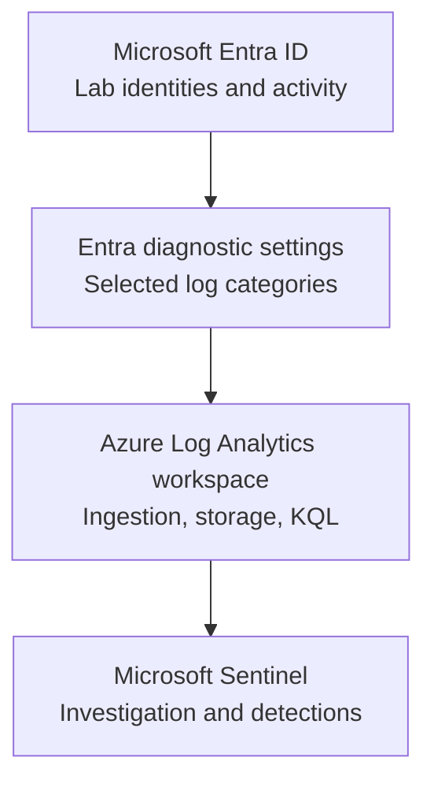

# Technical Implementation Report — Checkpoint 2: Range Setup

**Project:** Identity Recon — Identity Security Monitoring & Defense Lab (Cybernoia IAM Path)  
**Author:** Taiwei Ko  
**Date:** November 8, 2026  
**Environment:** Authorized, isolated training lab  
**Status:** Checkpoint reported complete; supporting evidence pending

## 1. Objective

Create an identity-security test environment with a centralized logging and monitoring pipeline to support future exercises involving authentication anomalies, identity changes, attack detection, and incident investigation.

## 2. Architecture



**Design rationale:** Separate the identity provider, telemetry routing, searchable log storage, and SIEM analysis functions. This creates a measurable pipeline that can be validated independently at each stage.

## 3. Implementation performed

| Workstream | Work reported by lab owner | Engineering relevance |
|---|---|---|
| Entra ID tenant | Set up and identified the lab identity environment | Provides a bounded identity test environment |
| Log Analytics | Created a workspace to receive and query logs | Centralizes telemetry for investigation |
| Microsoft Sentinel | Onboarded Sentinel to the monitoring workspace | Adds a SIEM analysis and investigation layer |
| Log ingestion | Completed the course's Entra diagnostic-routing/ingestion work | Connects identity activity to the monitoring pipeline |

**Configuration fields to capture before publishing a final implementation inventory:** workspace region, retention setting, diagnostic categories enabled, budget configuration, and test activity timestamps. Do not commit secrets, access tokens, or sensitive identifiers.

## 4. Validation plan and evidence

The owner reported completing Checkpoint 2. The following **verification artifacts have not yet been supplied for this report**; do not mark them independently verified until captured.

| Test | Evidence to save | Verification status |
|---|---|---|
| Tenant ready | Sanitized Entra Overview screenshot | Pending attachment |
| Workspace deployed | Log Analytics workspace Overview screenshot | Pending attachment |
| Sentinel connected | Microsoft Sentinel workspace view | Pending attachment |
| Diagnostic routing saved | Entra diagnostic settings showing destination and categories | Pending attachment |
| Sign-in records arriving | Dated `SigninLogs` query with non-empty results | Pending attachment |
| Audit records arriving | Dated `AuditLogs` query with non-empty results | Pending attachment |

### Example validation queries

```kusto
SigninLogs
| where TimeGenerated >= ago(24h)
| summarize EventCount=count(), LatestEvent=max(TimeGenerated)
```

```kusto
AuditLogs
| where TimeGenerated >= ago(24h)
| summarize EventCount=count(), LatestEvent=max(TimeGenerated)
```

**Interpretation:** A nonzero count demonstrates that records of that type were returned within the selected period. It does **not** independently validate full coverage, alerting, or detection effectiveness. Use test identities and sanitized data in screenshots.

## 5. Engineering observations

- **Primary lesson:** Centralizing logs is a prerequisite for investigating identity activity; it is not a substitute for testing detections.
- **Potential failure modes:** Wrong workspace or directory selected, unsupported log categories, missing Azure permissions, ingestion delay, no test activity, overly short query window, or cost/retention misconfiguration.
- **Separation of concerns:** Entra provides identity events; diagnostic settings export selected categories; Log Analytics stores and queries records; Sentinel uses available data for security operations.

## 6. Security outcome and next milestone

**Outcome reported:** An Entra-based lab monitoring foundation using Log Analytics and Microsoft Sentinel, with ingestion configuration completed as part of Checkpoint 2.

**Evidence still needed:** Screenshots and actual query output showing the intended records were received. Once collected, update this report from “reported” to “validated,” with dates and artifacts.

**Next milestone:** Checkpoint 3 — Attack Box Build. Keep offensive simulations inside the authorized training tenant and document technical controls and test outcomes without publishing credentials or sensitive infrastructure details.

## 7. Suggested evidence file names

```text
evidence/
  checkpoint-02-entra-overview-redacted.png
  checkpoint-02-workspace-overview-redacted.png
  checkpoint-02-sentinel-connected-redacted.png
  checkpoint-02-diagnostic-settings-redacted.png
  checkpoint-02-signinlogs-results-redacted.png
  checkpoint-02-auditlogs-results-redacted.png
```

Attach only the screenshots that materially prove the milestone. A few clear, sanitized pieces of evidence are better than a large collection of unannotated portal screenshots.
