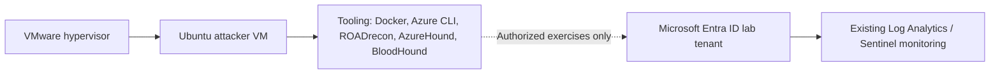

# Technical Implementation Report — Checkpoint 3: Attack Box Build

**Project:** Identity Recon — Identity Security Monitoring & Defense Lab  
**Author:** Taiwei Ko  
**Date:** November 8, 2026  
**Environment:** Authorized, isolated training lab  
**Status:** Setup complete (self-reported); no screenshots required for this checkpoint; tool operation not independently verified

## 1. Objective

Build a dedicated, virtualized Ubuntu workstation to support controlled identity-security assessments against an **owned, authorized Microsoft Entra ID lab tenant**. This checkpoint focuses on deploying and preparing the tool environment, not conducting attacks or establishing detection coverage.

## 2. Environment architecture

*The dashed connection represents intended future authorized exercises. It does not indicate that an attack, scan, authentication, or successful telemetry capture was performed during Checkpoint 3.*

## 3. Implementation summary

| Component | Work completed (reported) | Purpose |
|---|---|---|
| VMware | Provisioned a virtual machine for the assessment workstation | Isolates assessment tooling from the primary computer |
| Ubuntu | Installed as guest operating system | Provides the Linux operating environment |
| Docker | Installed | Supports containerized tool workloads |
| Azure CLI | Installed | Enables command-line Azure and Entra administration/testing in the authorized lab |
| ROADrecon | Installed | Supports identity-environment inventory and assessment workflows |
| AzureHound | Installed | Supports collection of Azure/Entra relationship data for authorized analysis |
| BloodHound | Installed | Supports identity relationship visualization and privilege-path analysis |
| VM reboot | Reboot performed as part of setup (as described by the lab owner) | Completes installation/setup sequence; not treated as a separate security tool |

**Scope limitation:** VMware product/edition, VM resource allocation, Ubuntu version, tool versions, Docker service state, authentication setup, and BloodHound deployment mode were not supplied and are intentionally not asserted here.

## 4. Completion and documentation approach

**Checkpoint disposition:** Setup completed as reported by the lab owner. No screenshots, command-output artifacts, or evidence folder are required for this setup-only checkpoint.

**Recorded implementation:** VMware Ubuntu virtual machine prepared with Docker, Azure CLI, ROADrecon, AzureHound, and BloodHound installed. This report is the checkpoint deliverable.

**Verification boundary:** Tool versions, runtime health, connectivity to the lab tenant, and successful execution have not been independently verified. The report documents installation, not test results or demonstrated detection capability.

**Practical readiness note:** Before starting Checkpoint 4, confirm locally that the VM boots, required services/tools launch, and networking is appropriately restricted. These checks can remain private unless they produce a meaningful finding for a later case study.

## 5. Security considerations and engineering decisions

- **Authorization:** Use tooling only against the owned and explicitly authorized lab tenant; do not target other tenants, users, or organizations.
- **Containment:** Keep assessment tools inside the Ubuntu VM. Before testing, confirm whether VMware uses NAT, host-only, or bridged networking and understand the associated exposure. Avoid unnecessary publicly accessible services.
- **Credential safety:** Do not upload CLI token caches, authenticated session files, BloodHound data sets, secrets, or identity exports to GitHub.
- **Recovery:** Take a VM snapshot after verifying a healthy baseline, before future exercises.
- **Monitoring:** Keep the Checkpoint 2 Entra → Log Analytics → Sentinel telemetry pipeline available for future tests. Installation alone does not demonstrate that any activity was detected.
- **Tool reproducibility:** Record validated software versions and OS version locally or in sanitized text so the lab can be recreated.

## 6. Outcome and next milestone

**Reported outcome:** A VMware-hosted Ubuntu assessment VM with Docker, Azure CLI, ROADrecon, AzureHound, and BloodHound installed. This establishes the tooling foundation for subsequent authorized identity-security exercises.

**Not yet demonstrated:** End-to-end tool operation, successful authorized tenant interaction, relationship collection, attack execution, BloodHound graph data, or Sentinel detection and incident response. These belong in later checkpoints; Checkpoint 3 deliberately omits evidence attachments.

**Next milestone:** Checkpoint 4 — Recon & Initial Access. Keep future activity inside the authorized training range, define an explicit test objective, and validate defensive telemetry before drawing conclusions.

---

*Portfolio note: This document reports hands-on learning in an educational lab; it is not a production security attestation or an endorsement by Microsoft or Cybernoia Labs.*
