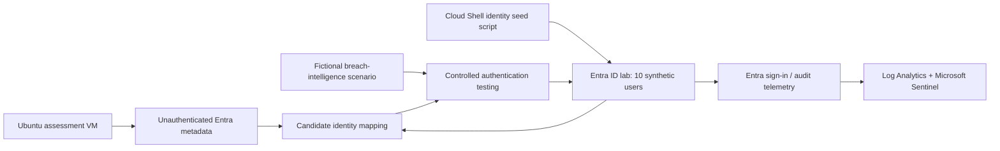

# Checkpoint 4 — Reconnaissance & Initial Access
## Technical Security Assessment | Identity Recon IAM Path

**Prepared by:** Taiwei Ko  
**Exercise date:** November 8, 2026 (reported)  
**Report revised:** November 9, 2026  
**Environment:** Personally controlled, isolated Microsoft Entra ID training tenant  
**Scope:** Synthetic identity provisioning, unauthenticated tenant metadata discovery, account-discovery concepts, password spraying, and a modeled credential-stuffing scenario  
**Status:** Identity seeding reported complete; reconnaissance and authentication testing described by the lab owner. Specific login successes, test output, and defensive detections have not been independently verified.  
**Classification:** Educational security assessment — not a production engagement

## 1. Executive summary

This checkpoint examined how an attacker can develop an identity-focused attack path from publicly accessible tenant metadata to attempted authentication. The lab began by provisioning **10 synthetic employee identities** into a Microsoft Entra ID tenant using a seed script in Azure Cloud Shell. An Ubuntu attacker VM, prepared in Checkpoint 3, served as the authorized assessment workstation.

The exercise explored unauthenticated discovery through Microsoft identity endpoints and the distinction between **password spraying** (testing a small number of candidate passwords across many accounts) and **credential stuffing** (testing previously obtained username/password pairs). A fictional breach-intelligence scenario was added to explain how attackers might obtain candidate credentials. **No real dark-web account acquisition is claimed.**

The exercise's purpose is to understand the attack chain and the defensive controls that should interrupt or detect it. This report does not publish test passwords, live credential pairs, reusable attack scripts, or sensitive tenant identifiers.

## 2. Scope, assets, and rules of engagement

| Item | Authorized scope |
|---|---|
| Identity provider | Personally controlled Microsoft Entra ID lab tenant |
| Users | Ten synthetic employees created for testing |
| Attacker workstation | VMware-based Ubuntu VM |
| Provisioning environment | Azure Cloud Shell seed script |
| Recon tools | `curl`, `jq`, Microsoft public identity metadata endpoints |
| Authentication exercise | Controlled tests against synthetic lab identities only |
| Telemetry baseline | Log Analytics and Microsoft Sentinel configured in Checkpoint 2 |

**Boundaries:** No testing of external organizations, real people's accounts, actual leaked credentials, credential theft, production systems, or persistence. Passwords used for lab simulations must be synthetic and reset after testing. Stop testing if rate limits or controls are triggered.

## 3. Attack-path and monitoring architecture



**Architectural principle:** Tenant discovery and account authentication are different operations. The existence of a public identity endpoint is not itself an access-control failure. The security risk develops when valid identities and weak or reused credentials are combined with ineffective authentication protections.

## 4. Phase 1 — Seed synthetic employee identities

**Reported activity:** Executed an identity seed script in Azure Cloud Shell to populate **10 fictional employee accounts** in the lab tenant. This established a controlled identity population for discovery and authentication exercises.

**Why it matters:** A realistic IAM environment includes multiple identity objects, attributes, and authentication events. Synthetic accounts allow repeatable security testing without involving real employee data.

**Validation status:** Ten-account creation is reported by the lab owner; account inventory output has not been attached to this assessment.

## 5. Phase 2 — Unauthenticated tenant discovery

**Objective:** Determine which information a remote client can retrieve from public Microsoft identity endpoints **before obtaining an access token or logging into the tenant**.

On the Ubuntu VM, verify the availability of the local HTTP/JSON utilities:

```bash
curl --version
jq --version
```

The following is an **illustrative, read-only metadata request** using a placeholder for a tenant that you own:

```bash
TENANT_DOMAIN="example-lab.onmicrosoft.com"  # Replace with your own lab domain
curl -fsS "https://login.microsoftonline.com/${TENANT_DOMAIN}/v2.0/.well-known/openid-configuration" \
  | jq '{issuer, authorization_endpoint, token_endpoint, jwks_uri}'
```

This endpoint exposes OpenID Connect discovery metadata designed for legitimate clients. Typical fields include the issuer URL, authorization endpoint, token endpoint, and JSON Web Key Set (JWKS) URI. **It does not return a directory-wide employee list or reveal passwords.** A successful response supports the narrow conclusion that the endpoint is reachable and tenant-specific metadata can be resolved.

The training scenario also discusses comparing account-check results for a known synthetic account and a deliberately nonexistent account. Treat any inferred user-existence result cautiously: response meanings and protections can vary. The exact account-check request, output, and negative-control results have not been supplied for verification.

**Risk observation:** Public identity metadata can support reconnaissance, but the exposed discovery document is generally intentional protocol behavior. The defensible finding is not “the tenant leaks credentials”; it is that identity exposure can become more consequential when combined with weak authentication and compromised credentials.

## 6. Phase 3 — Simulated compromised-credential intelligence

**Scenario assumption (fictional):** An attacker obtains a list of email addresses and suspected password pairs from a breach marketplace or leaked dataset. For this portfolio, those are **synthetic, lab-created test identities and passwords**, not real dark-web material.

Two potential initial-access methods are explored:

| Technique | What the attacker tests | Typical weakness |
|---|---|---|
| **Password spraying** | A limited candidate password across multiple accounts | Common or predictable passwords; inadequate protections |
| **Credential stuffing** | Previously obtained username/password pairs | Password reuse across services |

A successful account login, if observed, would need to be demonstrated with the relevant test timestamp, matching sign-in result, and an indication of whether MFA or Conditional Access interrupted the session. A password match alone is not necessarily equivalent to full interactive access.

**Evidence distinction:** The earlier course walkthrough contains examples of three successful password guesses. Those examples are **not attributed to this lab's observed results** without evidence. No real dark-web discovery and no confirmed number of compromised accounts are claimed in this report.

## 7. Phase 4 — Controlled authentication exercise

The authorization scope was restricted to the lab tenant and its seeded synthetic users. The exercise's high-level workflow was:

1. Create an authorized set of synthetic test accounts and lab passwords.
2. Separate the **password-spraying** scenario from the **credential-stuffing** scenario so findings have clear attribution.
3. Conduct the lab's controlled authentication tests against the synthetic accounts only.
4. Note the test window, observable response categories, and any lockout or MFA interruption.
5. Review the corresponding sign-in activity on the defender side and reset intentionally weak credentials after testing.

**Execution details intentionally excluded from the public portfolio:** Attack automation, reusable credential lists, passwords, account enumerators, and working authentication scripts. Their absence does not affect the security narrative or remediation recommendations.

**Outcome status:** The offensive exercises are described as part of the completed learning checkpoint, but this report does **not** independently verify which test accounts accepted credentials, whether sessions were established, or whether alerts fired.

## 8. Findings and defensive analysis

| ID | Observation | Security significance | Evidence status |
|---|---|---|---|
| IR-04-01 | Ten synthetic accounts were seeded in Entra ID | Provides an isolated, repeatable test population | User-reported |
| IR-04-02 | Public identity metadata can be requested without authentication | Supports tenant discovery; usually intended protocol functionality | Example read-only request documented; actual command output not attached |
| IR-04-03 | A password-spray scenario illustrates the impact of shared weak credentials | Potential account takeover if authentication controls fail | Lab methodology described; individual compromises unverified |
| IR-04-04 | Fictional leaked credentials illustrate credential-stuffing risk | Password reuse can turn a breach elsewhere into an Entra access attempt | Hypothetical scenario, **not** actual leaked data or proven compromise |
| IR-04-05 | The Checkpoint 2 monitoring pipeline is available for testing | Enables analysis of identity sign-ins and changes | Prior checkpoint validated sign-in and audit-log ingestion; Checkpoint 4-specific outcomes unverified |

### Defensive recommendations

- Require **phishing-resistant MFA** for higher-risk access wherever feasible; apply Conditional Access thoughtfully to the lab's test identities.
- Reduce password reuse and weak-password exposure through appropriate password protection and user practices.
- Review Entra smart lockout, Identity Protection signals, and Conditional Access outcomes as applicable to the tenant and licensing.
- Investigate groups of failed sign-ins across multiple accounts, unusual success-after-failure patterns, and changes in sign-in risk.
- Preserve dated and sanitized evidence of what was actually observed, including **blocked attempts**, not just successes.
- Rotate weak passwords and revoke test sessions when the exercise ends.

## 9. Lessons learned

- **Reconnaissance is not authentication:** Publicly available OpenID metadata is not a successful login and should not be mischaracterized as a vulnerability.
- **Spraying and stuffing are different:** One tests candidate passwords across users; the other tests previously collected account/password pairs.
- **Access does not equal undetected access:** A missing visible popup does not mean there were no Entra sign-in records or security signals.
- **Evidence quality matters:** Findings must distinguish reported steps, fictional threat assumptions, and verified results.
- **Identity defense is layered:** Credential controls, MFA, Conditional Access, logging, investigation, and recovery complement each other.

## 10. Scope limitations and next actions

**Not yet independently documented:** Command responses for discovery, controlled sign-in test results, credential acceptance counts, MFA/Conditional Access behavior, and Checkpoint 4-specific detections.

**Before treating this as a confirmed compromise assessment:** Record an anonymized test window, number of simulated accounts targeted, outcome counts (blocked/failed/succeeded), and relevant defender observations. Do not include raw credentials or source datasets.

**Next checkpoint:** Post-Exploitation — continue only within the authorized training environment, with an emphasis on identity impact, observable defender signals, and remediation.

---

*This educational report is based on the lab owner's description and a clearly marked fictional breach-intelligence scenario. It makes no claims about real victims, real leaked credentials, or production compromise.*
