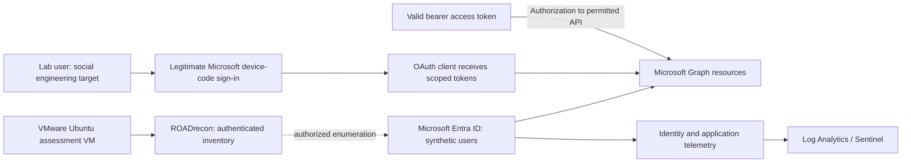

# Checkpoint 5 — Post-Exploitation: Authenticated Enumeration, Device-Code Phishing & Token Replay

**Project:** Identity Recon — Identity Security Monitoring & Defense Lab  
**Prepared by:** Taiwei Ko  
**Date documented:** November 9, 2026  
**Environment:** Privately controlled Microsoft Entra ID training tenant  
**Status:** Exercises completed as reported by the lab owner; results have not been independently audited  
**Classification:** Educational, authorized lab assessment — not a production incident

## 1. Executive summary

Following the synthetic identity preparation and initial-access scenarios of Checkpoint 4, this exercise evaluated what an authenticated identity can discover and how trust in legitimate Microsoft authentication mechanisms can be abused. It comprised three phases:

1. **Authenticated enumeration:** Used the ROADrecon GUI to review directory objects and relationships accessible to a compromised synthetic lab identity.
2. **Device-code phishing simulation:** Modeled an IT impersonation scenario in which a second synthetic lab user was misled into approving a legitimate device-code authentication flow for a client application.
3. **Token extraction and replay:** Demonstrated, in the controlled lab, that possession of a valid bearer access token could allow Microsoft Graph requests without a new interactive sign-in during the token's validity window.

This lab illustrates two distinct security problems: **socially engineered authorization** and **misuse of bearer credentials after authentication**. Nothing in this exercise demonstrates unrestricted tenant administration or complete MFA bypass across all resources.

## 2. Scope and safeguards

| Area | Assessment boundary |
|---|---|
| Assets | Owned and explicitly authorized Microsoft Entra ID training tenant |
| Identities | Synthetic lab users; not real employees |
| Operator system | VMware Ubuntu assessment VM prepared in Checkpoint 3 |
| Tools/services | ROADrecon GUI, Microsoft identity platform, scoped Microsoft Graph requests |
| Data | Synthetic directory objects reachable under the lab account's permissions |
| Excluded | Real-world phishing, third-party accounts, leaked credentials, publication of active tokens or password material |

**Safety note:** No phishing-email templates, live device codes, bearer tokens, token-cache paths, or ready-to-replay requests are included in this public report. Replace any user names, domains, tenant identifiers, and downloaded directory records with sanitized descriptions before publishing supporting artifacts.

## 3. Architecture and trust boundaries

**Trust-boundary observation:** A user authenticating to a legitimate identity provider does not imply the request originated from a legitimate IT process. Similarly, API authorization using a bearer token proves possession of a valid credential, not the physical identity or device of the requester.

## 4. Exercise A — Authenticated tenant enumeration with ROADrecon

**Reported activity:** Used an authenticated synthetic lab account to access the ROADrecon GUI and examine identity information retrievable from the tenant.

**Security relevance:** Authenticated discovery can reveal users, groups, application registrations, directory relationships, and other objects **subject to the identity's granted permissions and the tool's collected data**. The exercise helps evaluate least privilege and the information exposed following account compromise.

**Outcome boundary:** The lab owner reported viewing and collecting accessible tenant data, but the exact object counts, permissions, export contents, and collection timestamps have not been provided for independent verification. No claim is made that all directory data or privileged objects were accessible.

## 5. Exercise B — Device-code phishing / trusted workflow abuse

**Reported activity:** Performed a simulation using two synthetic accounts. Acting as an internal IT persona, the operator induced another lab identity to complete a device-code authorization step on a genuine Microsoft sign-in experience. The second identity believed the request related to device compliance, but the actual authorization context was a client application.

**Observed security issue, as reported:** The authentication service and its page were legitimate; **the misleading business pretext was not**. An unsuspecting person may complete an authentication ceremony without recognizing which application or session they are authorizing.

**Technical interpretation:** Device-code phishing can result in the initiating client receiving user-delegated tokens after a user authorizes the flow. This is better described as **authorization-flow abuse**, not necessarily theft of an existing browser session. The final permissions remain constrained by the client, scopes, consent, Conditional Access and other enforcement controls.

**Validation boundary:** The lab owner reported a successful approval and token issuance; application/client identifiers, delegated permissions, Conditional Access results, and defender telemetry have not been independently reviewed. No real person's mailbox was contacted or implicated in this report.

## 6. Exercise C — Access-token extraction and replay

**Reported activity:** From an authenticated synthetic identity's local test environment, the lab owner retrieved a bearer access token, ended the interactive session, and demonstrated subsequent Microsoft Graph access using that token without another interactive password/MFA step. The reported Graph response included directory identities visible to that token.

**Why it matters:** Bearer-token possession can allow resource access while a token is valid and authorized. A user logging out of a client does not, on its own, demonstrate that every previously issued access token has been invalidated for all resources.

**Important limits:**

- The token is issued for a particular audience/resource and limited scopes or roles; it is **not** a universal tenant key.
- A valid token can permit permitted API requests without a fresh interactive authentication prompt. That does **not** mean there was no original sign-in event or no observable application/API activity.
- Expiration, account changes, revocation mechanisms, Continuous Access Evaluation (when supported), and policy enforcement can limit subsequent token use.
- The observed Graph inventory does not establish privileged access or unrestricted tenant compromise.

**Validation boundary:** Token contents, timing, Graph response fields, actual privilege scopes, and sign-in event correlation were not supplied for independent analysis. No token strings or replay instructions are included.

## 7. Preliminary findings and risk assessment

*Risk levels below are **qualitative lab scenario assessments**, not measured production risk scores.*

| ID | Finding | Scenario severity | Confidence / evidence |
|---|---|---|---|
| IR-05-01 | Compromised identity can enumerate accessible directory relationships | Moderate, depending on permissions | Authenticated ROADrecon exploration reported; permission scope unverified |
| IR-05-02 | Device-code sign-in can be socially engineered using a legitimate Microsoft page | High where flow is permitted and approvals are misunderstood | User-reported simulation; precise token/client scope unverified |
| IR-05-03 | Possession of a valid bearer token can permit API access without another interactive challenge | High where tokens are exposed and data is sensitive | User-reported Graph token reuse; expiry and claims not verified |
| IR-05-04 | Logging and detection for these exercises have not been assessed | Monitoring assurance gap | Earlier Checkpoint 2 ingestion was verified; Checkpoint 5-specific alerting is not verified |

## 8. Defensive controls and remediation priorities

| Priority | Control | Reason |
|---|---|---|
| P1 | **Restrict/block device-code flow** using Conditional Access where not required; assess policy impact in report-only mode first | Reduces exposure to device-code phishing while preserving authorized exceptions |
| P1 | **Protect endpoints and cached credentials**; prevent token disclosure, use endpoint protection, and minimize local administrative access | Reduces opportunities for bearer-token extraction |
| P1 | **Revoke the affected lab sessions and credentials after testing**; evaluate response to token misuse | Limits residual access after exercise completion |
| P2 | **Review client/app access and delegated permissions**, with least privilege and consent governance | Limits the data available to a socially engineered or compromised client |
| P2 | **Review authentication-protocol, application and sign-in telemetry** and correlate with relevant security events | Aims to distinguish legitimate device-code use from suspicious authorization patterns |
| P2 | **Use Conditional Access, phishing-resistant authentication where appropriate, and Continuous Access Evaluation-capable services** | Strengthens identity and session protections; no individual control guarantees prevention of every stolen-token scenario |
| P3 | **Document clear device-code approval guidance** for lab users and administrators | Reduces social engineering success involving legitimate sign-in pages |

## 9. Evidence and verification status

**No evidence attachments are required to record that the training exercise was performed.** For a higher-confidence security assessment, attach *sanitized* proof if available: directory object count (not individual records), authentication protocol/client application details, non-sensitive API result summary, test timestamps, and corresponding defender observations. Never upload actual bearer tokens, user codes, working credential exports, or live device-code requests.

| Claim | Current status |
|---|---|
| ROADrecon authenticated exploration | Reported complete; object/permission scope unverified |
| Device-code simulation and client token issuance | Reported complete; conditions and logs unverified |
| Reuse of a bearer token for permitted Graph requests | Reported complete; token claims and API scope unverified |
| Entra log ingestion (prior checkpoint) | Verified in Checkpoint 2 for SigninLogs and AuditLogs at the recorded test time |
| Device-code alerts / token replay detections | Not assessed in this checkpoint report |

## 10. Engineering conclusions and next steps

The lab showed how identity abuse can progress after obtaining user access: directory reconnaissance, trust-based approval of an OAuth flow, and possession-based API access. The principal architectural lesson is that **authentication, authorization, token protection, and monitoring are separate controls** that must work together.

**Next steps:** Sanitize or purge any token artifacts and synthetic sensitive exports, revoke test sessions, validate authorized app permissions, and review monitoring evidence where available. Subsequent checkpoints should assess privilege boundaries, consent policy, and persistence-related risks without assuming that token reuse alone grants elevated roles.

---

### Microsoft documentation

- [Protect identities and secrets; restrict device-code flow](https://learn.microsoft.com/entra/fundamentals/zero-trust-protect-identities)
- [Authentication flows in Conditional Access](https://learn.microsoft.com/entra/identity/conditional-access/concept-authentication-flows)
- [Access tokens in Microsoft identity platform](https://learn.microsoft.com/entra/identity-platform/access-tokens)
- [Continuous Access Evaluation in Entra](https://learn.microsoft.com/entra/identity/conditional-access/concept-continuous-access-evaluation)

*This is a public-facing educational case study based on the lab owner's self-reported activities. It does not constitute an independently audited penetration test or a production compromise report.*
