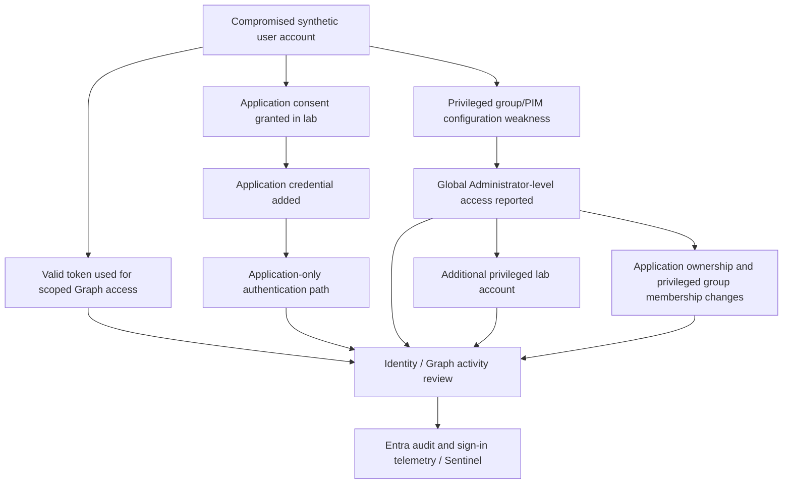

# Checkpoint 6 — Escalation & Persistence
## Technical Identity Security Assessment | Identity Recon IAM Path

**Prepared by:** Taiwei Ko  
**Documentation date:** November 12, 2026  
**Exercise dates:** Not recorded in this report  
**Environment:** Personally controlled, authorized Microsoft Entra ID training tenant (not production)  
**Status:** Exercises completed as reported by the lab owner; command output and identity audit records were not independently reviewed  
**Evidence policy:** Terminal-based work; no screenshots or exported evidence required for this portfolio checkpoint  
**Classification:** Educational security assessment; not a production incident or penetration-test attestation

## 1. Executive summary

Checkpoint 6 assessed how control of an identity can develop into **privileged access and multiple persistence paths** inside an Entra ID tenant. The sequence built on the controlled initial-access and post-exploitation exercises from Checkpoints 4 and 5. The lab owner reports using a synthetic IT-support identity, an application registration, and privileged directory relationships to demonstrate token-based access, broad application consent, non-human authentication, privilege escalation, an additional privileged account, and less-visible ownership or membership relationships.

The central security lesson is that **account recovery alone may not remove an attacker's access** when independent application credentials, other privileged identities, role assignments, or ownership relationships remain in place. Successful completion of an authentication flow also does not establish that later use of the resulting token is legitimate.

**Reporting boundary:** All outcomes below are user-reported from an owned lab. No API responses, audit events, token claims, permissions inventory, or role assignment exports have been supplied for independent validation. The technical narrative is intentionally non-operational: it omits attack commands, application secrets, bearer tokens, sensitive object IDs, and reusable persistence procedures.

## 2. Authorized scope and lab context

| Component | Role in the exercise |
|---|---|
| Microsoft Entra ID tenant | Owned test environment containing synthetic users and application objects |
| IT-support persona | Initially lower-privileged lab user, identified in the exercise as `dnorman` |
| Assessment workstation | VMware-hosted Ubuntu virtual machine from Checkpoint 3 |
| Microsoft Graph | Resource API used to evaluate access under issued credentials and directory privileges |
| Application registration / service principal | Test application and non-human identity path |
| Privileged role-assignable group / PIM | Privilege boundary examined in the escalation exercise |
| Log Analytics / Microsoft Sentinel | Monitoring foundation built in Checkpoint 2; Checkpoint 6-specific detection results not provided |

All testing is described as taking place in the owner's isolated lab. No activity against external tenants, real users, or unrelated organizations is asserted.

## 3. Assessment sequence and trust boundaries

The diagram is a **reported attack-path model**, not proof that every transition was independently reproduced. In particular, the application consent, application-only privileges, and PIM group mechanics must be evaluated on their own terms rather than treated as interchangeable access rights.

## 4. Exercise results (user-reported)

### 4.1 Existing-token reuse and authenticated enumeration — continuity from Checkpoint 5

**Reported activity:** Retrieved a bearer access token from an authorized lab session for the synthetic support identity; after an interactive logout, used the still-valid token to request directory information through Microsoft Graph. Accessible synthetic identities were returned.

**Security interpretation:** A bearer token can grant API access **within its audience, permissions, validity, and resource-policy conditions** without a new interactive password/MFA prompt. Ending a visible session does not necessarily invalidate previously issued access tokens immediately. This is not evidence that MFA is universally bypassed, that every directory object was accessible, or that no log entries existed.

**Finding:** Session and token incident response must include token/session revocation considerations, resource-side enforcement, and evaluation of actual API access—not only password resets.

### 4.2 Application consent misuse

**Reported activity:** Registered a deceptive test application and obtained what the lab owner described as organization-wide approval from the synthetic support identity.

**Security interpretation:** Consent can grant an application permissions separate from the human account's ordinary session. The impact depends on the **exact delegated or application permissions**, the consent type, tenant settings, and the authority of the person granting the consent. A user pressing Approve is not automatically equivalent to verified tenant-wide *administrator consent*.

**Finding:** App consent policies and administrator-consent decisions require governance and review. **Verification still needed:** the actual consent grant type, permission scopes/roles, authorizing principal, and whether the grant was tenant-wide.

### 4.3 Application credential misuse / non-human identity access

**Reported activity:** Added a client secret to a test application under the operator's control, authenticated as the application, and retrieved tenant information available to that app.

**Security interpretation:** App-only authentication is distinct from human-user impersonation. The effective access is bounded by the service principal's granted application permissions, assigned roles, and the resource's authorization checks. An application credential may remain usable independently of changes to the original user's password; **it is not guaranteed to survive disabling the application, revoking applicable access, deleting the credential, token expiry, or other enforcement actions**.

**Finding:** Monitor application credential changes, owners, permissions, and service principal sign-ins. Do not assume non-human activity is invisible: Microsoft Entra provides service principal sign-in telemetry, subject to configuration and retention.

### 4.4 Privilege escalation through group / PIM configuration

**Reported activity:** Found a privileged group associated with Global Administrator rights and was able to add the previously low-privilege lab identity; the lab owner reports resulting administrative access.

**Security interpretation:** The failure mode would be **unauthorized control of membership in a role-assignable group** or an unsafe privileged-access workflow. PIM for Groups, role-assignable groups, eligible assignments, active assignments, and permanently active memberships are related but distinct mechanisms. This report does not assume that mere eligibility was equivalent to active Global Administrator access.

**Finding:** Review who may change role-assignable group membership and ownership, require governed/time-bounded privileged access where feasible, and examine any effective permanent role assignment. **Verification still needed:** assignment type (active or eligible), role assignment path, group protection settings, and effective administrator role after the change.

### 4.5 Additional privileged identity ("ghost admin")

**Reported activity:** After obtaining administrative privileges in the lab, created a separate synthetic account (exercise alias `Hackeradmin`), assigned a Global Administrator role through the administrative API, and reported successfully signing in with it.

**Security interpretation:** This demonstrates **independent privileged identity persistence** in the training scenario: disabling the initial support account would not, by itself, remove another active privileged account. The object is not necessarily literally *hidden*; it can appear in user inventory, role assignments, audit logs, and sign-in telemetry if those records are captured.

**Finding:** Respond to high-privilege identity compromise with a **tenant-wide search for newly created users, privileged roles, and unusual administrative activity**, not solely remediation of the first affected account.

### 4.6 Shadow application ownership and privileged group membership

**Reported activity:** Reviewed application registrations, added an additional owner to the deceptive application, and joined a privileged IT operations group (`it-op-admins` in the exercise). The lab owner reports confirming both relationships.

**Security interpretation:** Application owners may be able to change registration configuration or credentials, subject to Entra policies and role controls. Group membership can grant access depending on the group's assignments and the member's effective entitlements. **Neither ownership nor membership alone proves tenant-wide admin access** without examining linked privileges.

**Finding:** Review application owner changes and privileged group membership additions alongside direct role assignments. These are distinct persistence surfaces and should be included in identity threat-hunting and recovery reviews.

### 4.7 Federation trust abuse

**Not reported as completed.** Federation trust abuse was listed in the wider curriculum, but no federation configuration change or validation was described for this checkpoint. It is excluded from the completed findings.

## 5. Finding register

*Impact classifications below describe hypothetical enterprise consequences if similar weaknesses existed in production. They are **not measured production risk ratings** or verified vulnerabilities in an external organization.*

| ID | Reported condition | Potential impact | Confidence / outstanding detail |
|---|---|---|---|
| IR-06-01 | Valid access token reused after interactive logout | Scoped API access without fresh user authentication | Owner-reported; token claims, lifetime and logs not reviewed |
| IR-06-02 | Test app received broad consent | Unauthorized data access within granted permissions | Owner-reported; grant type and permissions unknown |
| IR-06-03 | App credential enabled independent sign-in | Non-human persistence and application-level access | Owner-reported; app roles and effective reach unknown |
| IR-06-04 | Privileged group membership resulted in reported admin rights | Tenant-wide administrative compromise if effective Global Administrator rights confirmed | Owner-reported; PIM/group assignment path unverified |
| IR-06-05 | Separate privileged lab identity created | Continued privileged access after initial identity recovery | Owner-reported; independent account sign-in claimed |
| IR-06-06 | Additional app owner and privileged group membership | Alternative paths to application control and assigned privileges | Owner-reported; effective entitlements unverified |

**Highest-impact pattern:** The combination of an initially compromised human identity, authorization/configuration changes, and new independent access paths. The strongest engineering takeaway is **multi-object containment and recovery**, rather than reliance on a single-account password reset.

## 6. Defensive controls and remediation design

### Immediate lab containment and cleanup (if these test artifacts are still active)

1. **Preserve a sanitized inventory** of created accounts, app registrations, service principals, grants, owners, credentials, and privileged group/role assignments without copying secrets into GitHub.
2. **Remove unauthorized privileged access** by disabling/reviewing the extra privileged account and revoking inappropriate direct and group-derived role assignments; confirm no other privileged identities were introduced.
3. **Contain application access:** disable the suspicious test enterprise application as appropriate, review and revoke unneeded OAuth consent grants or app roles, and remove added secrets/credentials and owners. Confirm intended remediation is effective before deleting objects needed for review.
4. **Recover human identities:** reset synthetic compromised credentials, revoke sign-in sessions/refresh tokens, and verify resource-side controls for already issued access tokens. Validate account recovery rather than assuming a password reset immediately invalidates every token.
5. **Recheck relationships and monitoring:** verify group membership/ownership, app ownership, role assignment changes, and service principal sign-ins; identify any unexpected surviving access routes.

### Preventive and detective control improvements

| Control domain | Engineering recommendation | Suggested validation (non-invasive) |
|---|---|---|
| Application governance | Restrict user consent appropriately, require review of high-privilege grants, and inventory app owners/credentials | Audit approval records and consent policy coverage |
| Workload identity | Prefer managed identities or workload identity federation when appropriate; rotate/remove unnecessary secrets; restrict granted app roles | Reconcile service principals and credential inventory to known owners |
| Privileged access | Use least privilege, role-assignable group protections, and PIM approval/activation/time limits where justified | Review assignment path, permanent active roles and membership-change authority |
| Identity lifecycle | Review newly created and recently privileged accounts, including break-glass exceptions | Perform periodic privileged identity reconciliation |
| Monitoring | Collect relevant `AuditLogs`, interactive/noninteractive sign-ins and service principal sign-ins; verify retention and Sentinel detection coverage | Compare documented changes to actual directory audit events |
| Incident response | Treat tokens, app credentials, consent grants, role memberships and account creation as separate containment targets | Conduct a post-cleanup access review and confirm access is removed |

**Monitoring caveat:** A token-authorized Graph call may not produce a new interactive sign-in event for every request, but the exercise does not establish a lack of audit or resource logs. Visibility depends on the operation and available logging sources.

## 7. Documentation and validation boundary

This checkpoint was completed primarily in a terminal. **No screenshots, terminal transcripts, raw Microsoft Graph responses, tokens, app secrets or KQL files are required for the public portfolio report.** The following evidence would increase confidence if collected privately during future retesting:

- Redacted audit events for app consent grants, credential additions, owners, user creation, group membership, and role assignments.
- Effective permissions before and after each controlled access change.
- A time-bounded log review of user and service principal authentication activity.
- Recovery checks confirming synthetic persistence paths have been removed.

**None of those artifacts is asserted as collected or validated here.** Reporting performed work transparently is preferable to inventing proof.

## 8. Lessons learned and next milestone

- **Privileged access is a graph, not a single account:** users, groups, roles, app owners, consent, and workload identities create connected access paths.
- **Non-human identities require governance:** application secrets, ownership, and permissions are credentials and entitlements with real security impact.
- **MFA is only one layer:** token handling and downstream authorization still matter.
- **Recovery requires scope:** removing the initial account is insufficient if other privileged users or app-based access paths survive.
- **Detection must be measured:** the existence of Sentinel and Log Analytics from Checkpoint 2 does not prove Checkpoint 6 alerts fired.

**Next milestone:** Validate the cleanup of lab persistence paths, then continue to the next assigned Identity Recon exercise. Federation trust abuse remains unreported and should not be marked complete unless it is actually performed.

## References (vendor guidance)

- Microsoft Learn — [Privileged Identity Management for Groups](https://learn.microsoft.com/en-us/entra/id-governance/privileged-identity-management/concept-pim-for-groups)
- Microsoft Learn — [Manage application consent requests](https://learn.microsoft.com/en-us/entra/identity/enterprise-apps/manage-consent-requests)
- Microsoft Learn — [Service principal sign-in logs](https://learn.microsoft.com/en-us/entra/identity/monitoring-health/concept-service-principal-sign-ins)
- Microsoft Learn — [Investigate illicit consent grants](https://learn.microsoft.com/en-us/security/operations/incident-response-playbook-app-consent)
- Microsoft Learn — [Continuous Access Evaluation](https://learn.microsoft.com/en-us/entra/architecture/resilience-with-continuous-access-evaluation)

---

*This is an educational assessment based on the lab owner's reported actions in a self-controlled tenant. It is not a claim that an external enterprise has been compromised or that all described paths evade logging, MFA, or security controls.*
