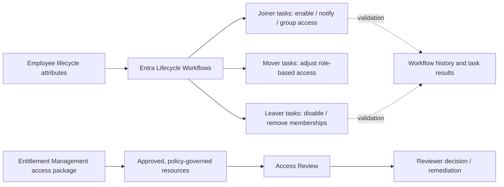

# Checkpoint 7 — Identity Governance: Joiner, Mover, Leaver, Entitlement Management & Access Reviews

**Project:** Identity Recon — Identity Security Monitoring & Defense Lab  
**Prepared by:** Taiwei Ko  
**Assessment date:** November 13, 2026  
**Environment:** Authorized Microsoft Entra ID Governance training tenant; synthetic lab identities  
**Status:** Configuration performed; **partial validation with identified onboarding failure**  
**Evidence:** Six sanitized screenshots, linked below  
**Classification:** Educational IAM engineering assessment — not a production audit

## 1. Executive summary

This checkpoint shifted from identity attack simulation toward preventive identity governance. I configured and examined lifecycle workflows for employee onboarding and offboarding, built an IT support access package, and configured an access review for an IT operations administrative group. A mover workflow was also reported as part of the lab work; mover-specific execution evidence was not supplied.

**The main learning outcome was not flawless automation—it was recognizing and assessing workflow outcomes.** The joiner test processed a lab user but the welcome-email task failed because the manager attribute was missing or invalid; a subsequent group-add task was cancelled. In contrast, the leaver test showed all three tasks completed, but the workflow's user summary was still **In progress** at capture time. The access review was created but **Not started**, and the access package had **zero assignments**. These distinctions are material to a credible control assessment.

## 2. Scope and objectives

| Governance capability | Intended control | Lab activity / evidence status |
|---|---|---|
| Joiner | Enable a new employee and deliver required onboarding tasks | Task execution observed, with one failure and one cancellation |
| Mover | Adjust access when an employee changes role or team | Configuration reported; not evidenced or executed in screenshots |
| Leaver | Disable a departing identity and remove related group/Teams memberships | Three tasks marked completed; run still in progress |
| Entitlement management | Bundle job-appropriate resources and govern request/assignment | Access package configured; no assignments tested |
| Access reviews | Reevaluate whether privileged group membership is still needed | One-time review configured; not started at capture time |

These demonstrations were conducted in a dedicated learning tenant. They do not represent production policy coverage or a completed access certification campaign.

## 3. Identity-governance architecture

**Design rationale:** Identity lifecycle automation reduces repetitive administrative steps, entitlement management standardizes access requests, and reviews provide a periodic check on continuing access. In production, each stage also needs correct employee attributes, testable outcomes, auditable approvals, and failure handling.

## 4. Test A — Joiner lifecycle workflow

**Lab identity:** Sarah Johnson (synthetic). **Observed:** One user processed; user status **In progress** when captured. The user summary showed three total tasks and one failed task.

| Task | Screenshot result | Interpretation |
|---|---|---|
| Enable User Account | **Completed** | Processing information indicates account was *already enabled*; this is not proof that the workflow performed the enabling change |
| Send Welcome email | **Failed** | Error states **manager attribute is missing or invalid** |
| Add user to groups | **Cancelled** | Intended group provisioning was not demonstrated |

**Finding GOV-07-01 — Incomplete onboarding due to identity-attribute dependency.** A workflow can start and process an identity while downstream tasks fail or are skipped. The root cause for the email failure is indicated by the screenshot; however, the exact required workflow parameters, mail/manager configuration, and reason the group task was cancelled require further inspection. Do not infer that the group task was cancelled *because* the email failed without reviewing task settings and execution history.

**Remediation and retest plan:**

1. Review the synthetic user's manager reference and required mail attributes, plus the welcome-email task's configured recipients and prerequisites.
2. Confirm the manager object is valid and expected task permissions are configured.
3. Inspect task ordering, error handling, and group-task dependencies; correct any invalid settings.
4. Run a new controlled joiner test with an appropriate synthetic account.
5. Verify the *resulting account state*, welcome-email task success, expected group membership, and **workflow completion**, not just a portal success indicator.

Evidence: [Joiner workflow history](../evidence/checkpoint-07/01-joiner-workflow-history.png) · [Joiner task results](../evidence/checkpoint-07/02-joiner-task-results.png)

## 5. Test B — Leaver lifecycle workflow

**Lab identity:** `tnguyen` (synthetic). The user summary at screenshot time showed one user processed, three total tasks, zero failed tasks, and an overall status of **In progress** (zero users marked successful or failed).

| Task | Screenshot result | Technical interpretation |
|---|---|---|
| Disable User Account | **Completed** | Evidence shows the disabling task ran successfully; verify final account state independently if needed |
| Remove user from all groups | **Completed** | Processing information says user was **not a member of any groups**, so no actual group revocations were observed |
| Remove user from all Teams | **Completed** | Processing information says user was **not a member of any teams**, so no actual Teams revocations were observed |

**Finding GOV-07-02 — Offboarding tasks completed, but end-to-end closure not yet demonstrated.** This screenshot supports a successful task sequence, not final workflow completion. It also does not test removal of actual memberships, access packages, privileged role assignments, applications, device access, or existing sessions.

**Retest plan:** After the run completes, capture its final status. For meaningful entitlement-revocation validation, use a separate synthetic account preassigned to a harmless lab group or test resource, then check membership before and after the offboarding workflow. Evaluate session revocation and other identities/credentials separately, consistent with Checkpoint 6 persistence lessons.

Evidence: [Leaver workflow history](../evidence/checkpoint-07/03-leaver-workflow-history.png) · [Leaver task results](../evidence/checkpoint-07/04-leaver-task-results.png)

## 6. Test C — Access package configuration

**Object:** `IT Support Packages` — under the `General` catalog (as displayed). The screenshot shows **one group/Teams resource role**, **one enabled policy**, **zero assignments**, and **zero pending requests**. An approval workflow and successful assignment were not visible in the image.

**Engineering significance:** An access package provides a governed bundle of resources and assignment policies. The configuration is an appropriate starting point for standardized birthright or request-based access, but the evidence does not yet show that a user requested, was approved for, received, or lost access.

**Validation to add later:** Create a harmless test request using a synthetic employee, confirm the applicable policy and approver decision (where required), compare group membership before and after assignment, and test expiry/removal if in scope.

Evidence: [Access package overview](../evidence/checkpoint-07/05-access-package-overview.png)

## 7. Test D — Access review configuration

**Object:** `IT Ops Admin rights`, targeting group `IT-Ops-Admins`. One-time review window shown: **November 13–16, 2026**. The screenshot shows **one member not reviewed**, zero approved, zero denied, and a review status of **Not started**. Selected reviewers were configured, but no reviewer action is evidenced.

**Finding GOV-07-03 — Access certification configured but not executed.** A configured review does not by itself demonstrate access recertification or removal of unnecessary privileged access.

**Validation to add later:** Once the review is active, submit and record a reviewer decision for a synthetic member. Inspect how the decision is applied, confirm membership changes if denial/removal is selected, and preserve a sanitized reviewer outcome and audit record. Treat automatic remediation as unverified until actually tested.

Evidence: [Access review overview](../evidence/checkpoint-07/06-access-review-overview.png)

## 8. Findings register and acceptance criteria

| Finding | Severity in lab | Current evidence | Closure condition |
|---|---|---|---|
| GOV-07-01: joiner task failure, later task cancelled | **Medium — workflow reliability** | Failed welcome email; cancelled group task | Clean end-to-end joiner rerun with account, communication and access state checked |
| GOV-07-02: leaver not fully closed and no actual membership revocation tested | **Medium — validation gap** | Three completed tasks; overall In progress; no source memberships | Final workflow completion plus before/after removal test |
| GOV-07-03: access review not started | **Low — pending governance test** | One member not reviewed | Review executed; reviewer decision and application verified |
| GOV-07-04: package assignment process unverified | **Low — pending validation** | One enabled policy, zero assignments | Approved/test assignment and intended access outcome demonstrated |
| GOV-07-05: mover execution undocumented | **Informational** | User-reported setup only | Sanitized mover trigger and before/after entitlement validation |

*Severity labels are illustrative for a lab, not assessed business-impact ratings for a production environment.*

## 9. Recommended architecture and operational controls

- Validate and maintain employee source-of-truth attributes (manager, hire/start and termination dates, department, job role) before lifecycle workflows run.
- Design retry/failure-handling and alerts for cancelled/failed onboarding tasks; track both workflow-level and task-level success.
- Enforce least privilege and explicit approval requirements for sensitive access packages, with expiration where appropriate.
- Test group removal against accounts that **actually have** test memberships; separately review standing admin roles, service principals, app ownership, credentials and sessions.
- Start, complete, and apply access reviews; audit the decision, notification, and remediation process rather than relying on a configuration screenshot.
- Use synthetic identities and avoid uploading secrets, full directory exports, real account identifiers, or sensitive approval details.

## 10. Conclusion and next actions

**Outcome:** Checkpoint 7 introduced all major components of an IAM governance program and produced meaningful operational observations. The joiner run revealed a real workflow error; the leaver tasks executed successfully, but the workflow had not yet reached a terminal status in the captured evidence. The access package and access review were configured but their assignment/reviewer workflows were not demonstrated.

**Priority order:** (1) fix and retest onboarding failure, (2) confirm final leaver status and test revocation of a real lab entitlement, (3) execute and verify an access review, (4) complete an access-package approval/assignment test, (5) capture mover proof where useful.

This report is a bounded educational record, not a production certification or an assertion that all governance controls are effective.

## 11. Sources and implementation references

- [Microsoft Learn — Lifecycle Workflows and task definitions](https://learn.microsoft.com/en-us/entra/id-governance/lifecycle-workflow-tasks)
- [Microsoft Learn — Workflow history](https://learn.microsoft.com/en-us/entra/id-governance/lifecycle-workflow-history)
- [Microsoft Learn — Entitlement management overview](https://learn.microsoft.com/en-us/entra/id-governance/entitlement-management-overview)
